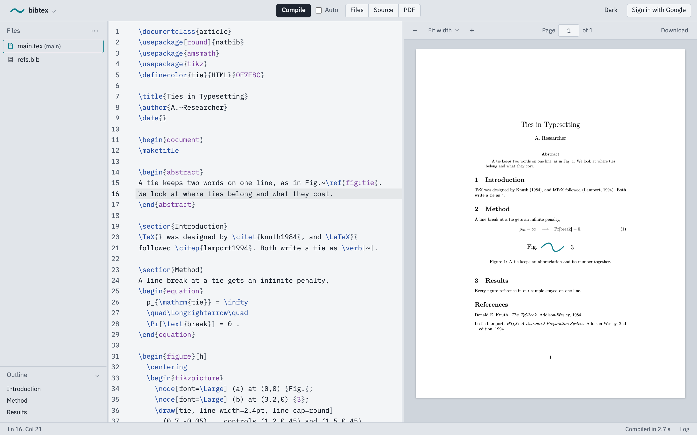
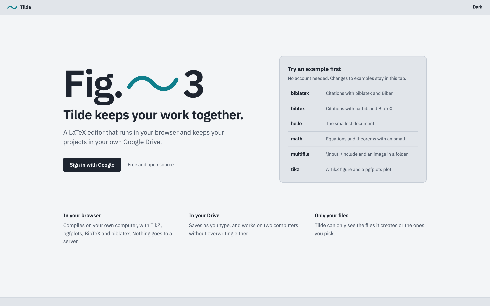

<p align="center">
  <picture>
    <source media="(prefers-color-scheme: dark)" srcset="docs/banner-dark.svg">
    
  </picture>
</p>

<h1 align="center">Tilde · LaTeX editor</h1>

<p align="center"><b>Keeps your work together, like Fig.~3.</b></p>

<p align="center">
  A free, open-source LaTeX editor that runs entirely in your browser<br>
  and keeps your projects in your own Google Drive. No server, no account of ours, no cost.
</p>

<p align="center">
  <picture>
    <source media="(prefers-color-scheme: dark)" srcset="docs/screenshots/editor-dark.png">
    
  </picture>
</p>

> **Status:** in development. Everything below works when you run Tilde on your own computer; a public site comes with the first release.

## Why Tilde

In LaTeX, a tilde (`~`) is a space that never breaks: `Fig.~3` keeps "Fig." and "3" on the same line. Tilde does the same for your work: your source, your PDF and your files stay together, on your own computer and in your own Drive.

It covers what a researcher writing a paper, a thesis or TikZ figures needs, with nothing in between you and your files.

## What works

**Writing**
- Editor with LaTeX colours, in light and dark, set in IBM Plex Mono
- Suggestions as you type: commands, environments, your `\label`s in `\ref{}`, your `.bib` keys in `\cite{}`, your files in `\input{}` and `\includegraphics{}`
- Brackets close by themselves, and Enter after `\begin{figure}` adds the `\end{figure}`
- Ctrl/Cmd+B and +I for `\textbf` and `\textit`, Ctrl/Cmd+/ to comment lines out
- An outline of your chapters and sections, through `\input` and `\include`; click to jump
- Multi-file projects with folders: new, upload or drag in files, add from Drive, rename or move, duplicate, delete, choose the main file
- Panes you can resize and hide (files, source, PDF); one at a time in a narrow window

**Compiling**
- pdfLaTeX from TeX Live 2026, running in your browser (WebAssembly)
- TikZ, pgfplots, BibTeX, natbib, and biblatex with Biber
- Packages beyond the basic set are fetched once and kept, so later compiles work offline
- Optional auto-compile a moment after you stop typing
- Errors and warnings in a list and as icons next to the line numbers; click one to jump to the file and line
- PDF zoom (fit width, fit page or a size), page numbers, and Download PDF

**Saving**
- Autosave to your Google Drive a few seconds after you stop typing
- Works from two computers: Tilde notices when a file changed elsewhere and never overwrites it silently. You choose: keep mine, keep Drive's, or download both
- Edits not yet in Drive are kept in your browser, so a closed tab or a lost network loses nothing
- File history comes from Drive's own version history

**Projects**
- Try it without signing in: six examples (a minimal document, maths, TikZ and pgfplots, BibTeX with natbib, biblatex with Biber, and a multi-file project)
- A project is a normal folder in your Drive, inside a projects folder that you can rename, move, or swap for another one
- Start blank or from an example, or import a `.zip` or files from your Drive
- Download any project as a `.zip`
- Search, sort, rename and delete (to Drive's trash, restorable for 30 days)

<p align="center">
  <picture>
    <source media="(prefers-color-scheme: dark)" srcset="docs/screenshots/welcome-dark.png">
    
  </picture>
</p>

## Keyboard shortcuts

| Keys | Does |
|---|---|
| Ctrl/Cmd+S | Save to Drive and compile |
| Ctrl/Cmd+B, Ctrl/Cmd+I | `\textbf{…}`, `\textit{…}` around the selection |
| Ctrl/Cmd+/ | Comment or uncomment the selected lines |
| Ctrl/Cmd+F | Find and replace in the open file |
| Ctrl/Cmd and + or −, over the PDF | Zoom the PDF (Ctrl/Cmd+0 fits the width) |
| Esc, on the project page | Back to the open project |

## Limits, and what to do instead

| Limit | What to do instead |
|---|---|
| **One person per project.** Real-time co-editing, track changes and comments need a server, and Tilde has none. | Send a co-author the project as a `.zip` (they can import it into their own Tilde) or the PDF. |
| **pdfLaTeX only** for now, so no `fontspec`, system fonts, or scripts such as Greek, Arabic or Chinese. | Use a font package made for pdfLaTeX, for example `\usepackage{newtxtext}` (Times-like), with `\usepackage[T1]{fontenc}`. Accented Latin letters typed directly (é, ü, ğ, ş) work. |
| **No shell escape**, so no `minted`. | Use `listings` for code, which needs no shell escape. |
| **One error at a time.** The engine stops at the first error. | Fix it and compile again; with *Auto* on, that happens by itself. |
| **Long documents compile more slowly** than with a local TeX Live. | While writing, compile one chapter with `\includeonly{chapters/method}`, or use `\documentclass[draft]{…}`, which skips images. |
| **The first compile downloads the TeX engine** (about 125 MB; about 30 MB more the first time Biber is used). | It happens once per browser; later visits load it from the cache. |
| **Your Google account's storage**: 15 GB on a free account, shared with Gmail and Photos. | LaTeX projects are small; images are usually what fills it. |
| **Brave and Arc** block the cookies Google's file picker needs. | Allow cross-site cookies for Tilde (Brave: the lion icon in the address bar) to use "Add from Google Drive". |

## Your data

- Tilde is a static website. There is **no Tilde server or database**; everything runs in your browser.
- It asks Google only for the `drive.file` permission: Tilde can see **the files it creates and the files you pick**, nothing else in your Drive.
- Your sign-in stays in the browser tab. Unsaved edits are kept in your browser until they reach Drive, and **signing out deletes them** (after offering to download anything unsaved).
- TeX packages are downloaded from TeXlyre's public package server, without any of your data.

## Run it yourself

You need Node.js 20.19 or newer (or 22.12+), and about 700 MB of disk space for the TeX engine.

```bash
git clone https://github.com/birdortyedi/tilde-latex.git
cd tilde-latex
npm install
npm run download-engine   # the TeX engine and TeX Live bundles, once per computer
npm run dev               # then open http://localhost:5173
```

The examples work right away. To use Google Drive, follow [docs/google-setup.md](docs/google-setup.md) (sign-in) and [docs/google-picker-setup.md](docs/google-picker-setup.md) (importing from Drive). The Picker key goes into a file `.env.local`, which is never committed.

```bash
npm test        # automated tests (Vitest)
npm run lint    # code style
npm run build   # the static site, in dist/
```

## How it works

```
  Your browser                                              Google
 ┌──────────────────────────────────────────────────┐      ┌────────────────┐
 │  editor ──▶ TeX engine (WebAssembly) ──▶ PDF     │      │  sign-in       │
 │    │                                             │      │                │
 │    └──▶ sync: autosave, conflict check, ─────────┼─────▶│  your Drive    │
 │              drafts kept in the browser          │◀─────┼  (drive.file)  │
 └──────────────────────────────────────────────────┘      └────────────────┘
```

The editor is CodeMirror, the PDF viewer is PDF.js, and the TeX engine runs in a Web Worker, so typing never waits for a compile.

Tilde is written in TypeScript, built with Vite, and served as static files.

## Credits

Tilde stands on the work of others:

- [TeXlyre BusyTeX](https://github.com/TeXlyre/texlyre-busytex) for TeX Live in the browser, and TeXlyre's package server
- [TeX Live](https://tug.org/texlive/) and the authors of every package in it
- [CodeMirror](https://codemirror.net), [PDF.js](https://mozilla.github.io/pdf.js/), [fflate](https://github.com/101arrowz/fflate) and [IBM Plex](https://github.com/IBM/plex)

Every dependency and its license is listed in [THIRD_PARTY_LICENSES.md](THIRD_PARTY_LICENSES.md).

## License

[AGPL-3.0-or-later](LICENSE). You may use, study, change and share Tilde. If you share a changed version, or run one as a service for others, you must publish your source under the same license.
