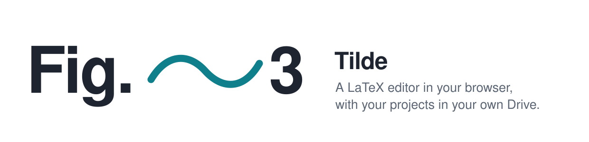
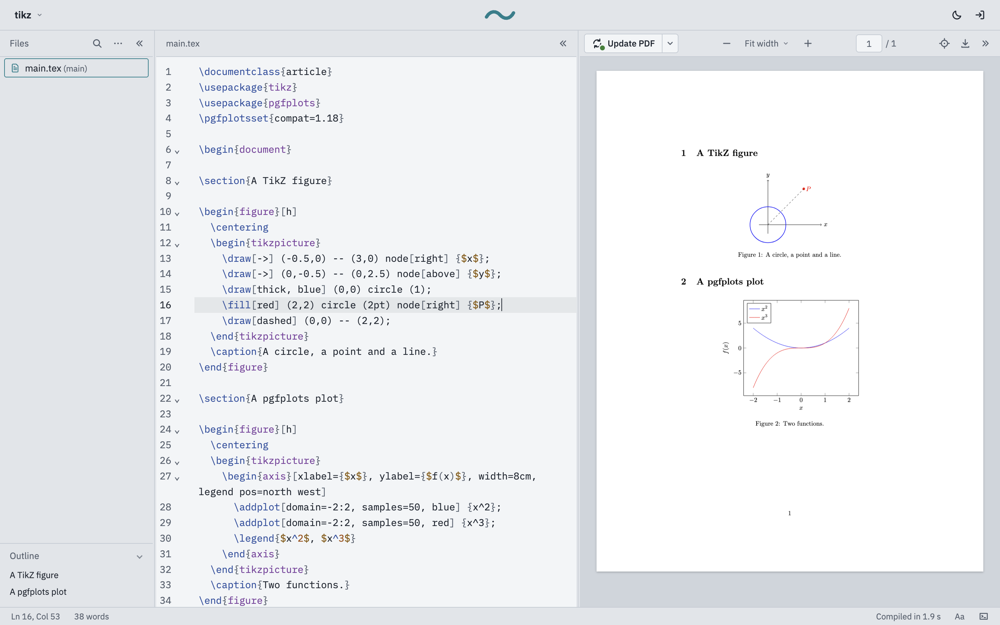
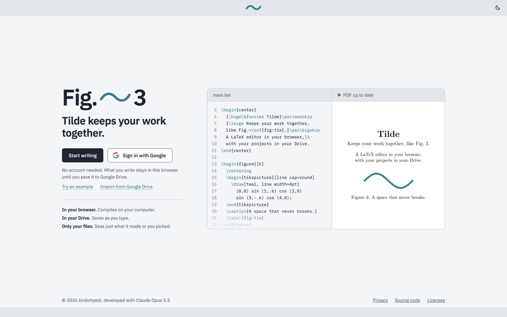
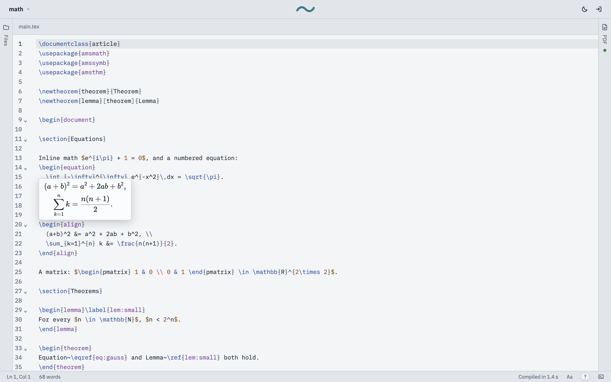
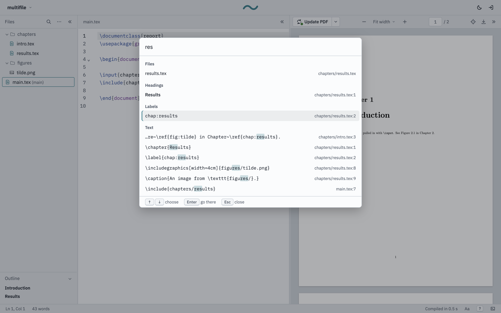
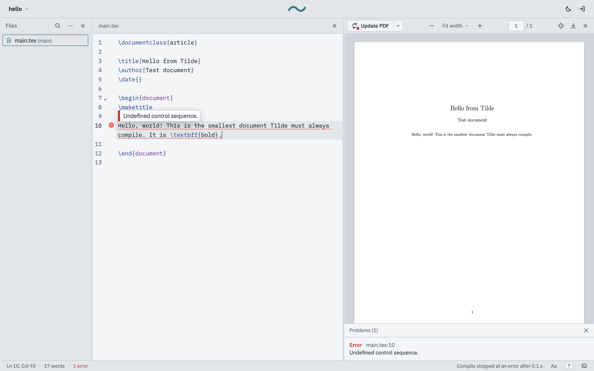
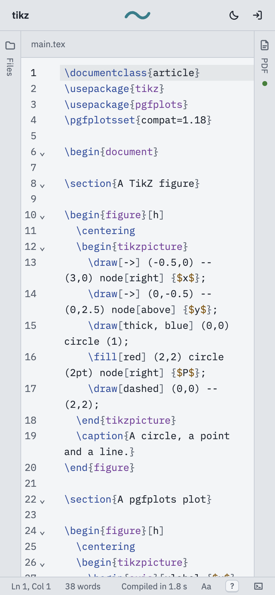
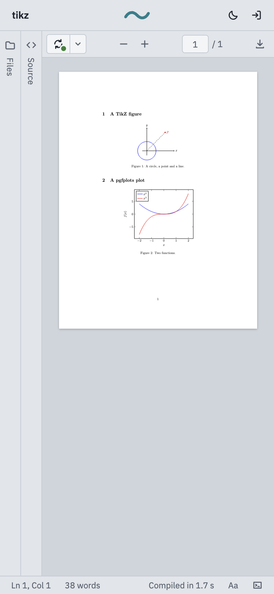
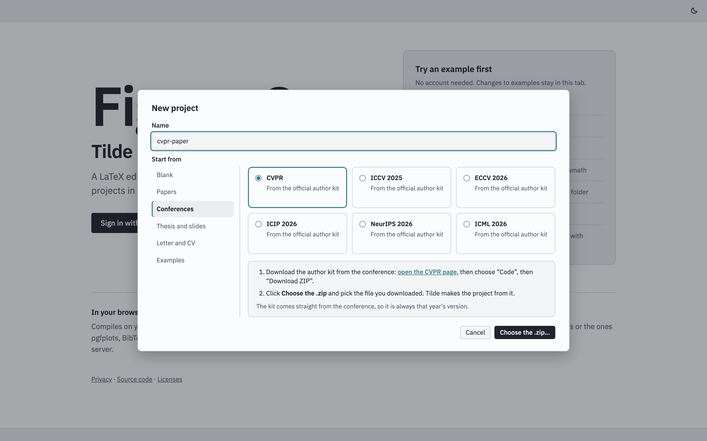

<p align="center">
  <picture>
    <source media="(prefers-color-scheme: dark)" srcset="docs/banner-dark.svg">
    
  </picture>
</p>

<h1 align="center">Tilde · LaTeX editor</h1>

<p align="center"><b>Keeps your work together, like Fig.~3.</b></p>

<p align="center">
  A free, open-source LaTeX editor that runs entirely in your browser<br>
  and keeps your projects in your own Google Drive. No server, no account of ours, no cost.
</p>

<p align="center">
  <picture>
    <source media="(prefers-color-scheme: dark)" srcset="docs/screenshots/editor-dark.png">
    
  </picture>
</p>

> **Status:** version 1.0. Tilde runs on your own computer: see [Run it yourself](#run-it-yourself). There is no public website yet.

## Why Tilde

In LaTeX, a tilde (`~`) is a space that never breaks: `Fig.~3` keeps "Fig." and "3" on the same line. Tilde does the same for your work: your source, your PDF and your files stay together, on your own computer and in your own Drive.

It covers what a researcher writing a paper, a thesis or TikZ figures needs, with nothing in between you and your files.

<p align="center">
  <picture>
    <source media="(prefers-color-scheme: dark)" srcset="docs/screenshots/welcome-dark.png">
    
  </picture>
</p>

## What works

**Writing**
- Editor with LaTeX colours, in light and dark, set in IBM Plex Mono
- Suggestions as you type: commands, environments, your `\label`s in `\ref{}`, your `.bib` keys in `\cite{}`, your files in `\input{}` and `\includegraphics{}`
- Brackets close by themselves, and Enter after `\begin{figure}` adds the `\end{figure}`
- Ctrl/Cmd+B and +I for `\textbf` and `\textit`, Ctrl/Cmd+/ to comment lines out
- Paste or drop an image into the text: it is saved in the project's image folder (`figures/` if there is none yet) and a figure for it is written at the cursor (never inside another figure), with `graphicx` loaded if needed. GIF, WebP and SVG images become PNG on the way in
- Paste cells from Excel, Google Sheets, Numbers or LibreOffice: they become a `booktabs` table (header row, numbers aligned right, special characters escaped), with the package loaded if needed. Inside a `tabular`, only the rows go in. "Paste as text instead" in the notice undoes it
- Go to anything with Ctrl/Cmd+K (or the magnifier above the files): files, headings, `\label`s, citation keys and text in every file of the project, in one list
- Maths preview: rest the pointer on maths (`$…$`, `\[…\]`, `equation`, `align` and the like) to see it typeset, with your own `\newcommand` macros. A quick preview by KaTeX; maths it does not know (a package's own commands) is typeset by the TeX engine instead, with your document's packages, and the preview says so. The PDF stays what counts
- Citations from a DOI or an arXiv link: type it inside `\cite{}`, or pick "Add a paper from its DOI…" there or in the "+" menu. Tilde fetches the BibTeX from doi.org, tidies it and adds it to your `.bib` file
- An outline of your chapters and sections, through `\input` and `\include`; click to jump
- Find and replace in the open file, with match case, whole words and regular expressions, and a count of the matches
- Fold environments and sections with the arrows next to the line numbers
- Spell checking by your browser, leaving out commands, labels, citation keys, file names and maths. The editor tells the browser the document's language from `babel` or `polyglossia`; Firefox then checks in that language (if its dictionary is installed), while Chrome, Edge and Safari use the languages set in the browser or the system
- Multi-file projects with folders: new, upload or drag in files, add from Drive, rename or move, duplicate, delete, choose the main file
- Panes you can resize (files, source, PDF), each with a header whose button folds it into a slim strip at the side; click the strip to bring it back. In a narrow window one pane shows at a time and the others wait as strips
- The editor's text size (Ctrl/Cmd and + or − while typing, or "Aa" in the status bar) and whether long lines wrap, remembered in your browser

<p align="center">
  <picture>
    <source media="(prefers-color-scheme: dark)" srcset="docs/screenshots/writing-dark.png">
    
  </picture>
</p>

<p align="center">
  <picture>
    <source media="(prefers-color-scheme: dark)" srcset="docs/screenshots/goto-dark.png">
    
  </picture>
</p>

**Compiling**
- pdfLaTeX, XeLaTeX and LuaLaTeX from TeX Live 2026, running in your browser (WebAssembly). Tilde picks XeLaTeX by itself when a project loads `fontspec`, `polyglossia` or `unicode-math`, and LuaLaTeX when it runs Lua (`luacode`, `\directlua`); a line `% !TEX program = lualatex` (or `xelatex`, `pdflatex`) in the main file chooses one
- Unicode text with XeLaTeX (Greek, Cyrillic, Arabic with `polyglossia`, Chinese with `xeCJK`), in the OpenType fonts that come with TeX Live (TeX Gyre, Libertinus, Noto, Amiri, Fandol and more) or in your own: upload the `.otf` or `.ttf` file, or in Chrome and Edge use "+" → "Add a font from this computer"
- TikZ, pgfplots, BibTeX, natbib, biblatex with Biber, and an index with `\makeindex`
- Packages beyond the basic set are fetched once and kept, so later compiles work offline
- Update PDF above the PDF (or Ctrl/Cmd+S), with a dot that tells whether the PDF matches the source: green when it does, amber when someone edited since, red when the last update stopped at an error. The dot shows on the folded PDF's strip too
- Optional "Compile as you type" (in the arrow next to Update PDF), a moment after you stop typing. It is quick: one LaTeX pass, reusing what the last compile learned (labels, page numbers, the bibliography), with a full run by itself when a new citation needs one. Update PDF and Ctrl/Cmd+S always do the full run
- Errors and warnings in a list and as icons next to the line numbers; click one to jump to the file and line. Common problems (a font that is not in TeX Live, characters a font lacks, EPS images, `minted`) come with a hint on what to do
- Optional "Show all errors" (in the arrow next to Update PDF): LaTeX goes on after an error instead of stopping, so the list shows every error and the PDF shows how far it got. Fix the first one first: later ones can be caused by it
- EPS images: "Convert EPS images" (in the same menu, or the button on the error) converts them to PDF in your browser with Ghostscript, for pdfLaTeX and LuaLaTeX. The converter (about 15 MB) downloads the first time; the converted files are not saved to your Drive
- The TeX engine starts loading as soon as you open a project, so the first compile waits less
- Jump between source and PDF (SyncTeX): double-click the PDF to go to its line in the source, or press Ctrl/Cmd+Shift+Enter (or the crosshair button) to see the cursor's line in the PDF
- Select and copy text in the PDF, and find it with your browser's search
- A word count of the PDF in the status bar
- PDF zoom (fit width, fit page or a size), page numbers, and Download PDF
- Share the PDF by link: Share PDF above the PDF saves it in the project's Drive folder and copies a link anyone can open, without an account (a supervisor, a reviewer). Update it to a newer PDF behind the same link, or stop sharing it
- Download for arXiv: in the project's ⋯ menu. Tilde compiles once more, then saves a `.zip` with your source and the compiled bibliography (`.bbl`), which arXiv and most journals ask for, without build files, and if you like without `%` comments (arXiv shows your source to everyone)

<p align="center">
  <picture>
    <source media="(prefers-color-scheme: dark)" srcset="docs/screenshots/error-dark.png">
    
  </picture>
</p>

<p align="center">
  <picture>
    <source media="(prefers-color-scheme: dark)" srcset="docs/screenshots/phone-editor-dark.png">
    
  </picture>
  <picture>
    <source media="(prefers-color-scheme: dark)" srcset="docs/screenshots/phone-pdf-dark.png">
    
  </picture>
</p>

**Saving**
- Autosave to your Google Drive a few seconds after you stop typing
- Works from two computers: when you come back to the tab, Tilde brings in what changed on the other one: edited, added, renamed and deleted files. It never overwrites a file silently. If a file changed in both places, you choose: keep mine, keep Drive's, or download both. A file deleted elsewhere that you had edited here is kept and saved again
- Edits not yet in Drive are kept in your browser, so a closed tab or a lost network loses nothing
- A safe copy of every file: before your first save in a session, Tilde asks Drive to keep the version you opened for good (Drive otherwise drops old versions after 30 days or 100 saves). The file's ⋯ menu then offers "Go back to the version from 10:42", which shows what changed and restores it. Earlier safe copies stay in Drive's "Manage versions"; Tilde never deletes a version
- Older versions are in Drive's own version history

**Writing together**
- Share a project from its ⋯ menu ("Share…") with up to four co-authors: Tilde shares its folder through Google Drive, and Google emails them a link. Opening it, they choose the project's files once in Google's file picker, and from then on the project is in their own project list ("Shared with you"), on all their computers
- Invite people to edit, or only to view (a supervisor, say: they read and compile, and see edits come in). The same panel shows who has access; the owner changes what someone may do or removes them there
- Comments in the margin: select text and click "Comment" (or Ctrl/Cmd+Alt+M); in a project of your own too, see below. The words are underlined, and a click opens the thread to reply or resolve. Comments stay on their words while anyone edits around them, are listed under the files, and never go into your `.tex` files; a notice tells you when someone else comments
- Edits from everyone merge by themselves, even made at the same moment or offline: there is no conflict to resolve, and Ctrl/Cmd+Z undoes only your own edits
- While you are in the project together, your browsers connect directly to each other: typing shows up at once, with each person's cursor and name. On networks that block direct connections, edits arrive through Drive a few seconds later. The faces of the others who are there show at the top right, ringed in the colour of their cursor, with a green dot while connected directly; click a face to go to that person's cursor
- The project stays an ordinary LaTeX folder in its owner's Drive: the owner's Tilde keeps the `.tex` files there up to date, and edits made to them outside Tilde (on the Drive website, with Drive for desktop, in another editor) are merged in. One that clashes with an edit made in Tilde at the same place is kept next to it as a copy, "main (changed outside Tilde).tex"
- Images a co-author adds: if your browsers are connected they arrive at once; otherwise an "Allow" button opens Google's file picker on exactly those files, which is what lets your Tilde read them
- Images a co-author adds are copied into the owner's folder where they belong (`figures/plot.png`), once the owner's Tilde can read them, so the folder stays a complete LaTeX project
- A file deleted in a shared project waits in ⋯ → "Recently deleted" for 30 days, where anyone can bring it back
- "Go back to the version from …" in a file's ⋯ menu works in shared projects too: once a day, Tilde asks Drive to keep the whole project as it was when someone started editing
- Leave a project someone shared with you from its ⋯ menu in the project list

**Projects**
- Write without signing in: "Start writing" on the welcome page makes a blank project kept in your browser; next time the button says "Continue writing". "Save to Google Drive" (in the status bar, or the project's ⋯ menu) signs you in and makes it an ordinary Drive project
- Try it without signing in: seven examples, from the simplest (a minimal document, maths, a multi-file project, TikZ and pgfplots, BibTeX with natbib, biblatex with Biber, Unicode text with XeLaTeX), under "Try an example" on the welcome page
- A project is a normal folder in your Drive, inside a projects folder that you can rename, move, or swap for another one
- Start a new project from a blank file, a starter (IEEE, ACM, Springer LNCS, a thesis with a file per chapter, beamer slides, a cover letter, a CV) or an example
- Conference papers from the official author kit: pick CVPR, ICCV, ECCV, ICIP, NeurIPS or ICML, download the kit from the conference's page (Tilde links to it) and choose the `.zip`. The kit comes from the conference, so it is always that year's version
- Import a `.zip` or files from your Drive
- Download any project as a `.zip`, or make a copy of it (also of a project shared with you)
- Your own starters: "Save as a starter…" in the project's ⋯ menu keeps the project as it is; New project offers it under "Yours", on all your computers (a lab's thesis template, say)
- Search, sort, rename and delete (to Drive's trash, restorable for 30 days)

<p align="center">
  <picture>
    <source media="(prefers-color-scheme: dark)" srcset="docs/screenshots/new-project-dark.png">
    
  </picture>
</p>

## Keyboard shortcuts

In the editor, press `?` (or click the `?` in the status bar) for this list, with the keys of your computer. Type to narrow it; Enter runs the command. It is part of Go to anything: start its search with `?`.

| Keys | Does |
|---|---|
| Ctrl/Cmd+S | Save to Drive and compile |
| Ctrl/Cmd+Shift+Enter | Show the cursor's line in the PDF |
| Double-click the PDF | Go to that line in the source |
| Ctrl/Cmd+B, Ctrl/Cmd+I | `\textbf{…}`, `\textit{…}` around the selection |
| Ctrl/Cmd+/ | Comment or uncomment the selected lines |
| Ctrl/Cmd+V with an image copied | Add the image to the project, with a figure for it at the cursor |
| Ctrl/Cmd+K | Go to a file, heading, label, citation key or text in the project |
| Ctrl/Cmd+Alt+M with text selected | Comment on it |
| Ctrl/Cmd+V with spreadsheet cells copied | Paste them as a table |
| Ctrl/Cmd+F | Find and replace in the open file; Enter for the next match, Shift+Enter for the previous one, Esc to close |
| Ctrl/Cmd and + or −, over the PDF | Zoom the PDF (Ctrl/Cmd+0 fits the width) |
| Ctrl/Cmd and + or −, in the editor | Larger or smaller text in the editor (Ctrl/Cmd+0 for the usual size) |
| Esc, on the project page | Back to the open project |

## Limits, and what to do instead

| Limit | What to do instead |
|---|---|
| **Your Google account's storage**: 15 GB on a free account, shared with Gmail and Photos. | LaTeX projects are small; images are usually what fills it. A safe copy of a `.tex` file takes a few KB. |
| **Comments need Tilde's shared format.** In a project of your own, the first comment changes the project to it: Tilde adds two files and a folder of its own ("Tilde shared project.tilde", "Tilde mailbox.tilde", "Tilde uploads") to the project's folder, and your `.tex` files stay as they are. | Nothing to do; a notice says when it happens. |
| **The maths preview is KaTeX first.** Maths it does not know is typeset by the TeX engine, which takes a second or two (longer while the PDF is compiling). | The PDF is always right; the preview is for checking a formula quickly. |
| **The first compile downloads the TeX engine** (about 125 MB; about 30 MB more the first time Biber is used). | It happens once per browser, and starts as soon as you open a project; later visits load it from the cache. |
| **Some networks block direct connections** between browsers (some company and university Wi-Fi). Then others' edits arrive through Drive, a few seconds behind, and their cursors do not show. | Nothing to do: edits still merge. A green dot on a person's face at the top right means your browsers are connected. |
| **In a shared project, only the owner invites people** or changes who has access. | Ask the owner. They can also share or stop sharing the folder in Google Drive itself. |
| **In a shared project, files whose names end in `.tilde`, and a top-level folder named "Tilde uploads", are left out:** those names belong to Tilde's own files. | Rename the file or folder. |
| **A project started without signing in lives only in that browser**, and browsers may clear it (Safari does after seven days without a visit). | Save it to Google Drive with the button in the status bar; it then works like any other project. Or download it as a `.zip` from its ⋯ menu. |
| **No shell escape**, so no `minted`. | Use `listings` for code, which needs no shell escape. |
| **EPS images** need a converter: "Convert EPS images" downloads Ghostscript (about 15 MB) the first time. It works with pdfLaTeX and LuaLaTeX, not XeLaTeX. | With XeLaTeX, convert them to PDF (most drawing and plotting programs export PDF), then add those. |
| **Brave and Arc** block the cookies Google's file picker needs. | Allow cross-site cookies for Tilde (Brave: the lion icon in the address bar) to use "Add from Google Drive". |
| **Files uploaded on the Google Drive website don't appear in Tilde**, even inside a project's folder. Tilde may only see the files it made itself and the ones you pick (the `drive.file` permission). Renaming or deleting a file on the website does come through. | Use "Add from Google Drive": it opens in the project's own folder, and the files you pick there join the project where they are. Or upload them, or drag them in. |
| **Fonts installed on your computer are not found by name**, so `\setmainfont{Arial}` fails. | Put the font file in the project and load it by file name: `\setmainfont{Arial.ttf}[Path=fonts/]`. In Chrome and Edge, "+" → "Add a font from this computer" copies a font and its bold and italic files for you. When a document asks for an installed font, the error offers "Add *font* from this computer" right there. Or use one that comes with TeX Live, such as TeX Gyre Termes (like Times) or TeX Gyre Heros (like Helvetica). |
| **Long documents compile more slowly** than with a local TeX Live. | Turn on *Compile as you type*: its quick compiles run LaTeX once instead of three or four times. For very long ones, compile one chapter with `\includeonly{chapters/method}`, or use `\documentclass[draft]{…}`, which skips images. |
| **Up to 5 people in a project, and no track changes.** | Share with the co-authors who write; invite others to view, or share the PDF by link. Suggest changes in a comment. |
| **Everyone who can edit a shared project is trusted with it.** Google Drive does not say who wrote what in Tilde's shared file, so a co-author could, for example, write a comment under someone else's name. Your other files are safe: Tilde opens only files in the project's own folder, whatever the shared file names. | Invite to edit only people you trust; invite others to view. |

## Your data

- Tilde is a static website. There is **no Tilde server or database**; everything runs in your browser.
- It asks Google only for the `drive.file` permission: Tilde can see **the files it creates and the files you pick**, nothing else in your Drive.
- Your sign-in stays in the browser tab. Unsaved edits are kept in your browser until they reach Drive, and **signing out deletes them** (after offering to download anything unsaved).
- Projects started without signing in are kept only in your browser, until you save them to Drive. They belong to no account, so signing out leaves them.
- TeX packages are downloaded from TeXlyre's public package server, without any of your data.
- "Add a paper from its DOI" sends only that DOI to doi.org, which answers with the paper's citation.
- Sharing the PDF by link makes that PDF viewable by anyone with the link, until you stop sharing it.
- In a shared project, Tilde reads and writes only the files in that project's folder, whatever its shared file says, so a co-author cannot reach your other projects through it.
- Tilde runs only in its own browser tab: it does not start inside another website's page, so no site can hide it there and trick you into clicking its buttons.
- In a shared project, your co-authors see your name, your Google profile photo, your edits and your comments. While you are in the project together, your browsers may connect directly (encrypted, with no server of ours in between), so each sees the other's IP address; Google's free STUN server helps them find each other.
- The full [privacy policy](public/privacy.html) is also shown in the app ("Privacy" at the bottom of the welcome page, and in the menu under your photo once signed in). Licenses of everything Tilde serves: [public/licenses/NOTICE.txt](public/licenses/NOTICE.txt).

## Run it yourself

You need [Node.js](https://nodejs.org) 22.12 or newer and Git. The TeX engine is a download of about 500 MB, of which Tilde keeps about 150 MB.

```bash
git clone https://github.com/birdortyedi/tilde-latex.git
cd tilde-latex
npm install
npm run download-engine   # the TeX engine, once per computer
npm run dev               # then open http://localhost:5173
```

Next time, `npm run dev` is all you need. Keep the address exactly `http://localhost:5173`: Google sign-in only works there. If something else already uses that port, `npm run dev` stops and says so; close the other program (or the other copy of Tilde) first.

- **The examples** work right away, without signing in.
- **Sign in with Google** works with Tilde's own Google app, so your projects go to your own Drive with no setup. To use a Google app of your own instead, follow [docs/google-setup.md](docs/google-setup.md).
- **"Add from Google Drive"** (Google's file picker) needs a Google Cloud setup of your own: your own sign-in client ID ([docs/google-setup.md](docs/google-setup.md)) and an API key in the same project ([docs/google-picker-setup.md](docs/google-picker-setup.md)). It is free and takes about 20 minutes. Everything else works without it.

Your own IDs go into a file `.env.local` next to `package.json`, which Git never commits.

To update Tilde later: `git pull`, then `npm install`.

```bash
npm test        # automated tests (Vitest)
npm run lint    # code style
npm run build   # the static site, in dist/
```

## How it works

```
  Your browser                                              Google
 ┌──────────────────────────────────────────────────┐      ┌────────────────┐
 │  editor ──▶ TeX engine (WebAssembly) ──▶ PDF     │      │  sign-in       │
 │    │                                             │      │                │
 │    └──▶ sync: autosave, conflict check, ─────────┼─────▶│  your Drive    │
 │              drafts kept in the browser          │◀─────┼  (drive.file)  │
 └──────────────────────────────────────────────────┘      └────────────────┘
```

The editor is CodeMirror, the PDF viewer is PDF.js, and the TeX engine runs in a Web Worker, so typing never waits for a compile.

A shared project's text is one [Yjs](https://github.com/yjs/yjs) document, saved as one file in the project's folder: Yjs merges edits from several people by itself, in any order, so saving never needs to ask whose version wins. The browsers of the people in a project introduce themselves through a small mailbox file in the same folder and then connect directly (WebRTC), so no server is needed for live editing either.

Tilde is written in TypeScript, built with Vite, and served as static files.

## Credits

Tilde stands on the work of others:

- [TeXlyre BusyTeX](https://github.com/TeXlyre/texlyre-busytex) for TeX Live in the browser, and TeXlyre's package server
- [TeX Live](https://tug.org/texlive/) and the authors of every package in it
- [CodeMirror](https://codemirror.net), [PDF.js](https://mozilla.github.io/pdf.js/), [fflate](https://github.com/101arrowz/fflate) and [IBM Plex](https://github.com/IBM/plex)

Every dependency and its license is listed in [THIRD_PARTY_LICENSES.md](THIRD_PARTY_LICENSES.md).

## License

[AGPL-3.0-or-later](LICENSE). You may use, study, change and share Tilde. If you share a changed version, or run one as a service for others, you must publish your source under the same license.

The starters in the New project dialog ([`starters/`](starters/LICENSE)) and the examples ([`test-docs/`](test-docs/LICENSE)) are [CC0 1.0](https://creativecommons.org/publicdomain/zero/1.0/): use them for your own papers, theses and slides with no conditions. Your documents are yours, whatever you start them from.
