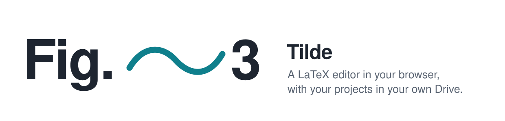

<p align="center">
  <picture>
    <source media="(prefers-color-scheme: dark)" srcset="docs/banner-dark.svg">
    
  </picture>
</p>

<h1 align="center">Tilde · LaTeX editor</h1>

<p align="center"><b>Keeps your work together, like Fig.~3.</b></p>

<p align="center">
  A free, open-source LaTeX editor that runs entirely in your browser<br>
  and keeps your projects in your own Google Drive. No server, no account of ours, no cost.
</p>

<!--
  Screenshots: add docs/screenshots/editor.png (a project open, with the PDF)
  and docs/screenshots/welcome.png, then remove this comment and the one below.
<p align="center"></p>
-->

> **Status:** in development. Everything below works on a local copy; the public site is coming with the first release.

## Why Tilde

In LaTeX, a tilde (`~`) is a space that never breaks: `Fig.~3` keeps "Fig." and "3" on the same line. Tilde does the same for your work: your source, your PDF and your files stay together, on your own computer and in your own Drive.

It is **Overleaf for one person, with your own storage.** It covers what a researcher writing a paper, a thesis or TikZ figures needs, without a server in between.

## What works

**Writing**
- Editor with LaTeX colours, in light and dark, with IBM Plex Mono
- Multi-file projects: `\input`, `\include`, images in folders, `.bib` files
- Files: new, upload, add from Drive, rename or move, duplicate, delete, choose the main file
- Panes you can resize and hide (files, source, PDF); one at a time in a narrow window

**Compiling**
- pdfLaTeX from TeX Live 2026, running in your browser (WebAssembly)
- TikZ, pgfplots, BibTeX and natbib
- Packages that are not in the basic bundle are fetched once and kept, so later compiles work offline
- Errors and warnings in a list and as icons next to the line numbers; click one to jump to the file and line

**Saving**
- Autosave to your Google Drive a few seconds after you stop typing
- Works from two computers: Tilde notices when a file changed elsewhere and never overwrites it silently. You choose: keep mine, keep Drive's, or download both
- Edits not yet in Drive are kept in your browser, so a closed tab or a lost network loses nothing
- File history comes from Drive's own version history

**Projects**
- A project is a normal folder in "LaTeX Projects" in your Drive
- Create one blank or from an example, or import a `.zip` (for example Overleaf's *Download source*) or files from your Drive
- Search, sort, rename and delete (to Drive's trash)

## What does not work

- **One person per project.** No real-time co-editing, track changes or comments (they need a server).
- **No Biber.** biblatex must use `backend=bibtex`. Plain BibTeX and natbib work.
- **No shell escape**, so no `minted` or `--shell-escape`.
- **One error at a time.** The engine stops at the first error; fix it and compile again.
- **Large documents compile more slowly** than with a local TeX Live installation.
- **Storage is your Google account's**: 15 GB on a free account, shared with Gmail and Photos.
- **Brave and Arc** block the cookies Google's file picker needs; allow cross-site cookies for Tilde to use "Add from Google Drive".

## Your data

- Tilde is a static website. There is **no Tilde server or database**; everything runs in your browser.
- It asks Google only for the `drive.file` permission: Tilde can see **the files it creates and the files you pick**, nothing else in your Drive.
- Your sign-in stays in the browser tab. Unsaved edits are kept in your browser until they reach Drive, and **signing out deletes them** (after offering to download anything unsaved).
- TeX packages are downloaded from TeXlyre's public package server, without any of your data.

## Run it yourself

You need Node.js 20.19 or newer (or 22.12+), and about 700 MB of disk space for the TeX engine.

```bash
git clone https://github.com/birdortyedi/tilde-latex.git
cd tilde-latex
npm install
npm run download-engine   # the TeX engine and TeX Live bundles, once per computer
npm run dev               # then open http://localhost:5173
```

The examples work right away. To use Google Drive, follow [docs/google-setup.md](docs/google-setup.md) (sign-in) and [docs/google-picker-setup.md](docs/google-picker-setup.md) (importing from Drive). The Picker key goes into a file `.env.local`, which is never committed.

```bash
npm test        # automated tests (Vitest)
npm run lint    # code style
npm run build   # the static site, in dist/
```

## How it works

```
 your browser                                                    Google
┌─────────────────────────────────────────────────────────┐    ┌──────────────┐
│ CodeMirror editor ──▶ TeX engine (WebAssembly, in a     │    │ Sign-in      │
│        ▲              Web Worker) ──▶ PDF.js viewer     │    │ Drive API    │
│        │                                                │◀──▶│ (drive.file) │
│   sync layer: autosave, conflict check, local drafts ───┼───▶│ your files   │
└─────────────────────────────────────────────────────────┘    └──────────────┘
```

Built with TypeScript and Vite, served as static files.

## Credits

Tilde stands on the work of others:

- [TeXlyre BusyTeX](https://github.com/TeXlyre/texlyre-busytex) for TeX Live in the browser, and TeXlyre's package server
- [TeX Live](https://tug.org/texlive/) and the authors of every package in it
- [CodeMirror](https://codemirror.net), [PDF.js](https://mozilla.github.io/pdf.js/), [fflate](https://github.com/101arrowz/fflate) and [IBM Plex](https://github.com/IBM/plex)

Every dependency and its license is listed in [THIRD_PARTY_LICENSES.md](THIRD_PARTY_LICENSES.md).

## License

[AGPL-3.0-or-later](LICENSE). You may use, study, change and share Tilde. If you share a changed version, or run one as a service for others, you must publish your source under the same license.
